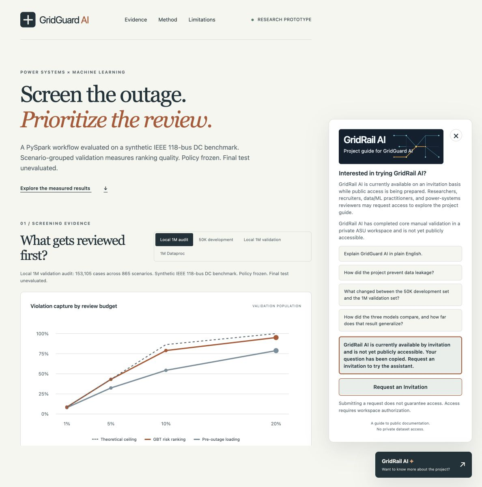
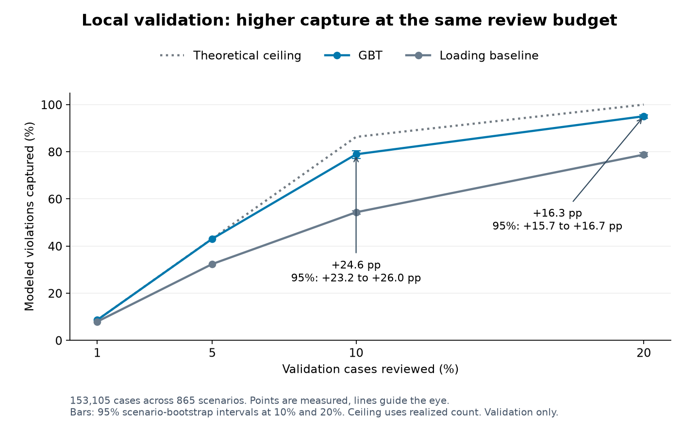

# GridGuard AI

**Contingency screening on a synthetic IEEE 118-bus benchmark with PySpark**

GridGuard AI studies whether a scalable machine-learning workflow can prioritize modeled post-outage transmission-grid violations under constrained review budgets. The project combines scenario-grouped validation, Spark pipelines and aggregate evidence in an interactive research dashboard.

[Live Dashboard](https://gridguard-ai.pages.dev) · [Request GridRail AI Access](https://docs.google.com/forms/d/e/1FAIpQLSddC199Z7tKwWrrFcPfUeZEiMqhM-7-hKzAlmLFpLpcesjSRA/viewform) · [Notebook](notebooks/00_gridguard_ai_flagship_report.ipynb) · [HTML Report](reports/GridGuard_AI_Flagship_Report.html)



> **Live dashboard:** GridGuard AI presents leakage-aware validation, review-budget analysis, reproducibility evidence, and the invitation-based GridRail AI project guide.

## Start Here

- [**Project Overview**](docs/PROJECT_OVERVIEW.md): high-level summary of what was built, validated, deployed, published, and what comes next
- [**Live Dashboard**](https://gridguard-ai.pages.dev): interactive validation evidence and GridRail entry point
- [**LinkedIn Walkthrough**](https://lnkd.in/p/gkxwd35u): 12-page visual project walkthrough
- [**Facebook Project Post**](https://www.facebook.com/sileshith/posts/pfbid0xiBU4DaSKEwdF3noXDxwWpjgbG7yMmMPg9rAadoEy7ezXNg6pq6AXcY99JZtXVy5l): business-oriented project introduction
- [**Portfolio Case Study**](https://hirpadata.com): recruiter-oriented presentation and related work
- [**Request GridRail AI Access**](https://docs.google.com/forms/d/e/1FAIpQLSddC199Z7tKwWrrFcPfUeZEiMqhM-7-hKzAlmLFpLpcesjSRA/viewform): invitation-based conversational project guide

## What GridGuard AI Does

Each observation pairs an operating scenario with a candidate transmission-line outage. The binary target, `Post_Outage_Violation`, identifies a modeled thermal-limit violation. A learned ranking determines which cases enter a fixed review budget first.

### Why This Project Exists

DC power flow and line-outage distribution factors provide controlled known-truth labels. The study uses this testbed to examine ranking, scalable Spark workflows and evaluation policies relevant to more expensive targets such as AC or N-k analysis. It does not demonstrate transfer to those targets or claim that DC/LODF labeling requires machine learning.

### Workflow

Synthetic scenarios → DC/LODF modeled labels → scenario-grouped split → PySpark ML pipeline → LR/RF/GBT comparison → review-budget evaluation → GridGuard dashboard → GridRail project guide.

## Why This Matters to the Energy Sector

Power-system reliability disruptions can carry substantial economic consequences, while demand and transmission constraints influence electricity-market conditions. [Berkeley Lab](https://eta.lbl.gov/publications/improving-estimated-cost-sustained) and [DOE](https://www.energy.gov/oe/articles/blackout-2003-blackout-final-implementation-report) provide broader reliability-cost context. [EIA](https://www.eia.gov/TodayinEnergy/detail.php?id=3150) explains the relationship between transmission constraints and locational prices.

GridGuard addresses a narrower question: when review capacity is limited, which modeled contingencies should be prioritized first? The current benchmark measures modeled violation capture, not financial savings. A planned extension will examine demand, renewable output, congestion, wholesale-price context and estimated consequence. See [energy-sector decision relevance](docs/ENERGY_BUSINESS_EXTENSION.md) and the [business-question matrix](docs/ENERGY_BUSINESS_QUESTION_MATRIX.md).

## Tech Stack

| Area | Tools and methods |
|---|---|
| Data & ML | Python, PySpark, Spark ML, NumPy |
| Cloud & Scale | Google Cloud Dataproc, Apache Spark |
| Modeling | Logistic Regression, Random Forest, Gradient-Boosted Trees |
| Evaluation | PR-AUC, ROC-AUC, scenario-grouped validation, review-budget analysis, scenario-cluster bootstrap |
| Frontend & Delivery | HTML, CSS, JavaScript, Cloudflare Pages, Google Forms |
| Reproducibility & Engineering | Git, GitHub, pytest. Dockerfile provided, container execution not verified. |

## Data and Method

| Property | Canonical 1M dataset |
|---|---:|
| Scenario-outage observations | 1,000,000 |
| Operating scenarios | 5,650 |
| Positive labels | 117,193 |
| Prevalence | 11.7193% |

The canonical dataset remains private. It is not distributed in this repository. The 50K development and 1M datasets share the same 5,650 operating scenarios, so they are not independent scenario cohorts. Rating calibration may overlap modeled scenarios. See the [data card](docs/DATA_CARD.md).

### Predictors

The nine predictors are `Total_Demand`, `Renewable_Generation_Pct`, `Hour_of_Day`, `Pre_Outage_Line_Loading`, `Line_Thermal_Rating`, `Edge_Betweenness`, `Degree_From_Bus`, `Degree_To_Bus` and `Line_Outage_Sensitivity`.

`scenario_id`, `outage_line_id`, `islanding_flag`, `random_seed` and `dataset_version` are excluded from the predictive feature vector.

### Leakage Prevention

The split assigns distinct scenario IDs to training, validation or test, then joins those memberships back to their outage rows. Scenario overlap across partitions is checked explicitly. Related rows stay together, and identifiers do not enter the model. See [Methods](docs/METHODS.md).

### Models

Logistic Regression, Random Forest and Gradient-Boosted Trees are three evaluated near-default Spark model families. They do not constitute an exhaustive model search or equal model-specific tuning budgets.

## Validation Results

**Fresh Dataproc validation, October 2026**

| Model | PR-AUC |
|---|---:|
| Logistic Regression | 0.8555 |
| Random Forest | 0.8683 |
| Gradient-Boosted Trees | 0.9250 |

The separate local 1M validation audit reports GBT PR-AUC of approximately 0.9247. Neither table describes the held-out 1M final test. The earlier 50K experiment includes an exposed development test and is retained as historical development evidence. [Results](docs/RESULTS.md) separates the evidence populations.

RF's fresh Dataproc PR-AUC falls within the 15-run local seed-and-partition range. The study does not isolate partition count as the unique cause. Original local precision of approximately 0.941 and fresh Dataproc precision of approximately 0.878 both fall outside the sensitivity range of approximately 0.890 to 0.937. That study used a different training-data layout. See the [RF reproducibility audit](docs/RF_REPRODUCIBILITY_AUDIT.md).

### Screening Performance



**Local 1M validation, pooled ranking**

| Review budget | GBT capture | Loading-baseline capture | Gain |
|---|---:|---:|---:|
| 10% | 78.9% | 54.3% | +24.6 percentage points |
| 20% | 95.1% | 78.8% | +16.3 percentage points |

The strongest tested simple baseline is `Pre_Outage_Line_Loading`. The paired scenario-bootstrap interval for the gain is approximately +15.75 to +16.72 percentage points, based on 1,000 resamples. **Intervals do not correct selection optimism or calibration overlap.** Baseline selection used these validation rows. GBT still missed **875 modeled violations** at the 20% pooled review budget.

Pooled ranking and within-scenario review are distinct policies. At 20% within-scenario review, mean recall was 93.80% for GBT versus 79.39% for loading. These estimates describe this synthetic benchmark, not measured engineering time, financial savings or real-grid benefit.

## Current Scope and Upcoming Work

| Current verified work | Upcoming energy-business extension |
|---|---|
| Synthetic IEEE 118-bus DC benchmark with 1M scenario-outage observations | Recover authenticated validation scores for demand-decile, renewable-share, hour-of-day miss and high-demand/high-loading analysis |
| Scenario-grouped LR/RF/GBT validation, PR-AUC, review-budget analysis, strongest tested simple baseline and paired scenario bootstrap | CAISO/EIA market context, congestion and electricity-price integration through defensible scenario alignment |
| GridGuard dashboard, GridRail private-workspace core validation and invitation access, public GitHub release and reproducibility audit | Estimated-consequence proxies, external/real-system validation and AC/security-analysis comparison |
| Frozen policy with final test unevaluated | Final-test evaluation only after separate explicit written authorization |

**PROPOSED / NOT YET MEASURED:** Economic Exposure Capture@k, Cost-Weighted Recall@k, Risk-Weighted Miss Rate, Economic Exposure Missed@k, Congestion-Weighted Capture@k and High-Price-Hour Capture@k. No real CAISO prices will be attached to existing synthetic rows without a defensible temporal and scenario mapping. See the [prioritized roadmap](docs/UPCOMING_WORK.md).

## Reproducibility

The original executable physics/data generator was not recovered. Full canonical dataset regeneration is not claimed. Exact sensitivity construction is not independently recoverable from the current public artifact set. Training and validation reproduction require authorized external canonical data. Public tests use synthetic software fixtures, and the notebook renders aggregate evidence without training or final-test scoring.

Local analysis used Python 3.11, Java 21 and PySpark 4.0.1. The fresh Dataproc run recorded Spark 4.1.2 and Python 3.12.13. The static dashboard requires no Python server beyond an optional local file server. See [environment and reproduction scope](docs/REPRODUCIBILITY.md) and [private-data access conventions](docs/PRIVATE_DATA_ACCESS.md).

```sh
python3.11 -m venv .venv
. .venv/bin/activate
python -m pip install -e '.[test,plots,report]'
python -m pytest -q
python scripts/build_dashboard.py
python scripts/serve_dashboard.py --port 8767
```

Open `http://127.0.0.1:8767`. No private dataset is required for these public tests or the dashboard build. Java 21 must be available for the synthetic Spark tests.

To rebuild the aggregate notebook and HTML report, install the report dependencies above and run:

```sh
python scripts/build_flagship_report.py
python scripts/validate_publication.py
```

The report build updates derived notebook outputs and HTML only. Data validation and pipeline entry points expose `--help`. Running them on canonical data requires separately authorized inputs. No command above evaluates the held-out final test.

## GridRail AI

GridRail AI is the conversational project guide for GridGuard AI. The Custom GPT has been created and core manual validation completed in a private ASU workspace. Public GPT sharing is disabled by the workspace. Visitors may [request invitation-based access](https://docs.google.com/forms/d/e/1FAIpQLSddC199Z7tKwWrrFcPfUeZEiMqhM-7-hKzAlmLFpLpcesjSRA/viewform). Submitting a request does not guarantee access. The dashboard copies starter questions and links to the form. It does not generate AI answers or connect to private data.

GridRail AI uses a dedicated navy, cyan and amber visual identity based on an abstract network with a highlighted screening path. The banner is a branding element for the project guide and does not represent the actual IEEE 118-bus topology or experimental evidence.

## Limitations

The study uses synthetic scenarios, simplified DC physics and modeled thermal limits. External validity is not established. There is no real utility deployment, AC security validation, operational authority or production safety claim. Models were not exhaustively tuned. Validation selection optimism remains, and GBT misses modeled violations. The held-out 1M final test remains unevaluated. See [Limitations](docs/LIMITATIONS.md).

## Final-Test Governance

**POLICY FROZEN / FINAL TEST UNEVALUATED**

No held-out 1M final-test PR-AUC is currently reported. A separate written approval is required before a single evaluation under the [frozen validation policy](docs/VALIDATION_POLICY_FREEZE.md).

### Repository Structure

```text
configs/        External-data configuration and frozen policy
src/gridguard/  Validation, splitting, modeling and screening
scripts/        Pipeline, report and dashboard tools
tests/          Synthetic software and aggregate checks
results/        Sanitized aggregate measurements and figures
dashboard/      Static dashboard source and local brand asset
notebooks/      Aggregate publication notebook
reports/        Self-contained HTML report
docs/           Methods, evidence, limitations and attribution
audit/          Selected public verification evidence
```

### Live Demo

[Explore GridGuard AI](https://gridguard-ai.pages.dev). The verified production release is V4-R2. V3 is retained privately as the rollback baseline. This repository does not publish deployment ZIPs, raw datasets, trained models, private GridRail knowledge packages or local Git history.

### License

[MIT](LICENSE) applies to original project code and documentation to the extent owned. Dependencies retain their own licenses. Canonical datasets, MATPOWER case files and restricted course material are not redistributed. See [attribution](docs/ATTRIBUTION.md) and [license/data scope](docs/LICENSE_AND_DATA_POLICY.md).

GridGuard AI originated as a Fall 2026 CIS 415 big-data project and was subsequently expanded into a reproducibility, validation and presentation workflow. Arizona State University affiliation is descriptive and does not imply endorsement.
