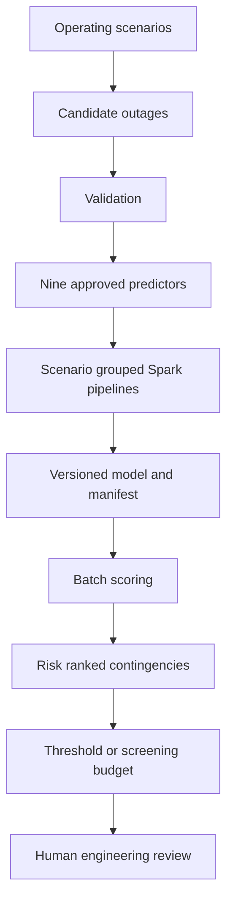

# Architecture

Implemented source includes input validation, grouped split, fitting, evaluation, provenance and scoring. Execution status is distinct and tracked in audit. PROPOSED production controls: drift monitoring, delayed-label performance monitoring, immutable registry, authenticated job submission, alerting and fallback to engineering review when data checks fail. No production service is deployed.

See [Results](RESULTS.md) for the three execution layers and current measurements.
